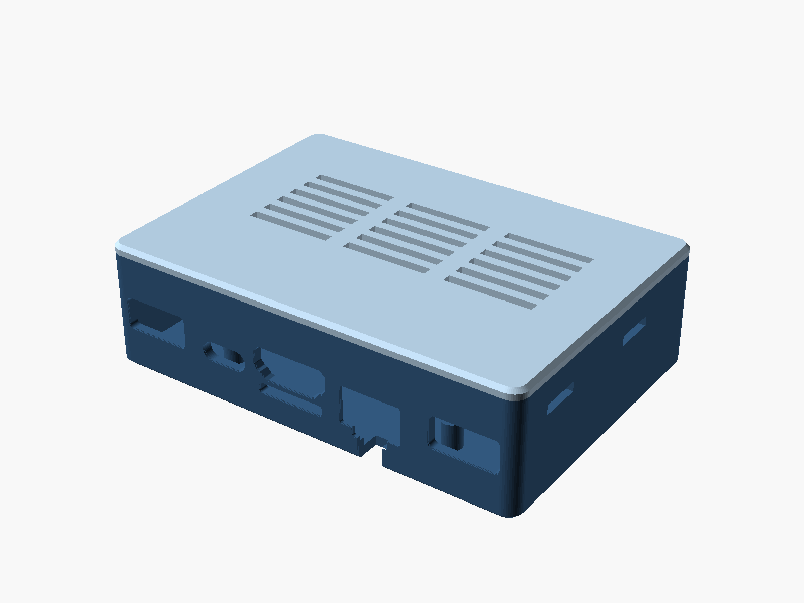

# VIM1S snap-fit case

A two-piece, 3D-printable OpenSCAD enclosure for the Khadas VIM1S V11 PCB.



The case has contoured USB-A, USB-C, HDMI and Ethernet openings, a separate
microSD slot, and three 4.5 mm pencil-access button holes. The rear and unused
GPIO opening are closed. The ventilated lid has a continuous locating ring
with integrated snap tabs. The exterior has 3 mm corner fillets followed by
0.8 mm, 45-degree top and bottom chamfers.

## Print and assemble

Download the ready-to-print [base](stl/vim1s-base.stl) and
[lid](stl/vim1s-lid.stl), or edit `vim1s-case.scad` and regenerate them.

- Overall assembled size: **88.3 x 62.4 x 25.5 mm**.
- PETG recommended; start with 0.2 mm layers and four perimeters.
- Print the base flat and the lid exterior-side down. Both STLs are already
  oriented for printing. Front-port overhangs may need supports.
- Place the PCB on the four locating pegs and press the lid into place.
- To open, release the two exposed catches opposite the buttons with a blunt
  plastic tool. Lift that edge and tilt the lid to disengage the hidden catches.

The enclosure allows a purchased **20 x 20 x 10 mm passive heatsink** on a
0.5 mm electrically insulating thermal pad, with approximately 3.03 mm roof
clearance. The preview heatsink is illustrative and is not part of the STLs.
Verify the actual heatsink, nearby components and thermal-pad suitability.

**Physical fit has not been verified by printing.** Check snap tension, PCB fit
and cable overmould clearance on a test print. The continuous ring shortens the
tabs' free bending length; do not force the lid if the catches are too stiff.
Print-fit parameters are near the top of the OpenSCAD source.

## Generate images and STLs

Install [OpenSCAD](https://openscad.org/downloads.html) and
[PowerShell 7](https://github.com/PowerShell/PowerShell). The scripts use only
these tools; no PCB model, FreeCAD or additional PowerShell modules are required.
The design and command-line generation were developed with OpenSCAD 2021.01.

From the repository root:

```powershell
pwsh -File .\scripts\render.ps1
pwsh -File .\scripts\export.ps1
```

Rendering writes eight 1600 x 1200 PNGs to `renders`: assembled, front,
rear/buttons, printable layout, exploded, open heatsink, exploded heatsink and
lid underside. STL export writes the base and lid to `stl`. Generated images and
STLs are checked in so the repository is usable without installing CAD tools.
Regenerate them when changing the design.

The scripts work with PowerShell 7 on Windows, macOS and Linux. They derive
the repository location from the script itself; no user-specific paths are
embedded. They find OpenSCAD on `PATH`, in the standard Windows installation,
or in `/Applications/OpenSCAD.app` on macOS. Pass its executable explicitly if
it is installed elsewhere:

```powershell
pwsh -File .\scripts\render.ps1 -OpenScadPath "C:\Program Files\OpenSCAD\openscad.com"
pwsh -File .\scripts\export.ps1 -Part lid -OutputDirectory "custom-stl"
```

On macOS or Linux:

```sh
pwsh -File ./scripts/render.ps1
pwsh -File ./scripts/export.ps1
# Optional override for a nonstandard installation:
pwsh -File ./scripts/render.ps1 -OpenScadPath /path/to/openscad
```

Relative output directories are repository-relative, even when invoking a
script from another working directory. Outputs are replaced only after a
successful, nonempty OpenSCAD export; failed temporary outputs are removed.

On a headless Linux machine, run PNG generation under a virtual X display:

```sh
xvfb-run -a pwsh -File ./scripts/render.ps1
```

### Optional local PCB preview

The supplied PCB STEP model, reference enclosure CAD and their converted meshes
are **not redistributed**. Obtain permission and your own compatible model if
you want a PCB preview. The source expects `pcb.stl` in the original V11 STEP
coordinate system; it applies the case-coordinate transformation itself.

Place your local `pcb.stl` next to `vim1s-case.scad`, then run:

```powershell
pwsh -File .\scripts\render.ps1 -ShowPcb
```

This writes to the ignored `renders-local` directory by default. The PCB mesh,
STEP/BREP files and ZIP archives are also ignored. The public previews do not
contain the supplied PCB or reference CAD geometry.

## License

[MIT](LICENSE). This license covers the case design and scripts in this
repository, not third-party hardware, CAD models or trademarks. This is an
unofficial project and is not affiliated with Khadas.
